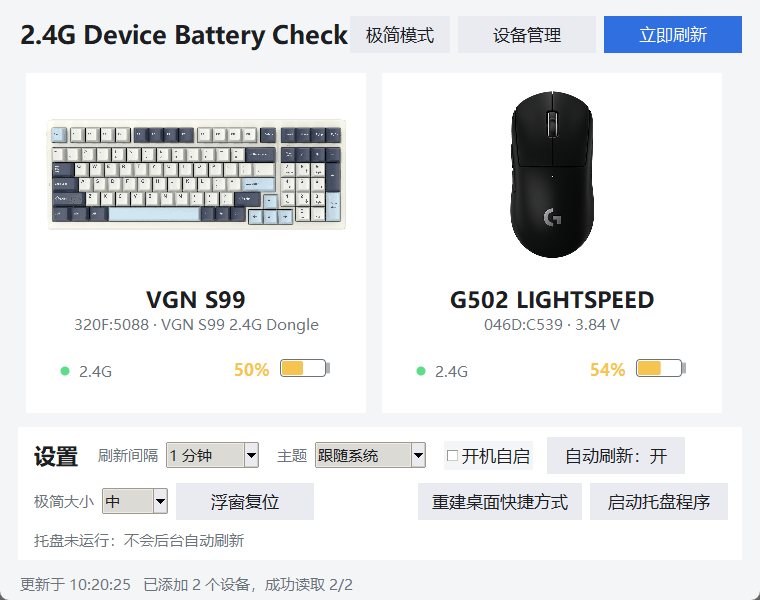

# 2.4G Device Battery Check

Windows 上实时读取 2.4G 无线外设电量的桌面小工具。**核心功能纯 ctypes 调系统 DLL，运行时零第三方依赖** ——
不用 hidapi、不用 pystray、不用 pywin32，装了 Python 就能跑；
唯一的可选增强是自定义背景（图片 / MP4）：源码用户 `pip install pillow` 即可解锁，
exe 版已把 Pillow 打进去。不想装 Python 的话，[Releases](../../releases)
里有打包好的单文件 `.exe`（双击就用）。



## ⚠️ 协议只认这几类设备

扫描能列出**任何能读到电量**的设备，但真正能读数的协议是逆向我们这几台具体设备得到的：
换成别的键盘或鼠标，大概率一个字节都读不出来（扫描时就不会出现）。
想加新设备：顺着 `battery.py` 里的策略表加一条协议，或者用 `app.py` 的调试版摸报文。

| 设备 | VID:PID | 读取方式 |
|---|---|---|
| VGN S99 键盘 | `320F:5088` | Telink 方案私有协议，厂商接口 `0xFF1C:0x0092`，Report ID `0x04`，`power_info` 命令 `0x1A`，电量取回复第 8 字节 |
| Logitech Pro X Superlight 鼠标 | `046D:C547` | 罗技 HID++ 2.0，Lightspeed 接收器，统一电池特性 `0x1004`，`GetStatus`(fn=1)，电量取回包 byte4 |
| Logitech G502 LIGHTSPEED 鼠标 | `046D:C539` 接收器 | 罗技 HID++ 2.0，但**没有** `0x1000`/`0x1004`，只有 `0x1001` 电池电压（**大端**毫伏，byte4-5）+ 标志字节（byte6）；百分比由电压曲线估算（`VOLTAGE_CURVE`） |

G502 这一行要注意：固件只报电压、不报百分比，所以界面上的 `≈N%` 是换算值，
副标题会显示真实电压（如 `3.58 V`），弹窗状态里标「电压估算」。
换算表在 `battery.py` 顶部的 `VOLTAGE_CURVE`，想微调只改这张表。

**你的设备不在这两行里？** 别硬改这个仓库，往下看「用 prompt 做一份你自己的」。

## 使用方法

**方式一（推荐给普通人）**：下载 Release 里的 `2.4G设备电量-v*.zip`，解压后双击
`2.4G设备电量.exe`。单文件、不弹黑框、任务栏显示自己的图标和名字（不是「Python」）。

**方式二（源码）**：

```bash
python my_battery.py
```

单进程程序：打开后自动在通知区域生成托盘图标，主界面按**设备表**显示设备卡片
（大号百分比 + 圆角电池条 + 数据来源），默认每 60 秒自动刷新。
充电时电池图标会「扫光」动起来，左下角直接显示「充电中 51%」这种实时电量。

主界面右上角只有三个按钮：**设置 / 极简模式 / 立即刷新**（极简是常用切换，留在主页一键直达）——
其余配置项都收进「设置」窗口，左侧分类导航：**外观 / 设备 / 刷新 / 启动与托盘 / 关于**，
主题、背景、设备扫描增删、刷新间隔、开机自启、托盘开关各归各类，
主界面只留设备卡片，不堆控件。

### 自定义背景：一张图或一段 MP4

设置 → 外观 → **「选择图片 / 视频」**：png / jpg / webp / gif / mp4 / mov / webm 都行，
软件自动做等比裁切 + 模糊 + 压暗，保证设备卡片上的文字始终读得清；
「压暗」「模糊」两个滑块可以自己微调，效果实时预览。

内存是硬约束，所以背景的实现刻意保守：

- **图片**：只保留一份缩到窗口大小的图（约 1~2 MB），模糊在小图上做，只缓存最近两份；
- **视频**：ffmpeg 解码上限 640×420、10 帧/秒，**同一时刻内存里只有一帧**（实测稳态
  内存占用 +1 MB 以内）；窗口比上限大时显示前才补一档缩放铺满；
- **窗口最小化 / 收进托盘 / 极简模式时自动暂停解码**，不烧 CPU 不费电；
- 视频背景需要系统能找到 `ffmpeg`（PATH 里有，或放到程序同目录）；图片背景只需要 Pillow。
  两者都没有时背景功能自动退回默认底色，程序其它功能不受影响。

### 氛围粒子：花瓣 / 雨滴

设置 → 外观 → **「氛围」**：无 / 花瓣 / 雨滴。设置背景之后，设备卡片是能透出背景的
**毛玻璃**（混一层主题色白霜底 + 双圈描边，运行中随时换背景都立即生效）；
氛围粒子飘在背景和卡片之间，让窗口看着更丝滑——纯 Canvas 绘制，
花瓣 30 片 / 雨丝 42 条，只在每帧更新几十个 item 的坐标，**CPU 占用接近 0**，
窗口隐藏/极简模式时自动暂停。

### 第一次使用：先扫描，再挑

主界面右上角 **「设置」→「设备」** → 打开页面自动扫描（也可以点「重新扫描」）→
列出本机所有**真能读到电量**的 2.4G 设备 → 逐个点 **「添加」** 或不管它 →
添加过的设备出现在主界面，随时可以点 **「移除」** 拿掉。
扫描还会把「检测到但协议暂不支持」的接收器（比如 DaiLing G3 这类耳机）列出来，
明明白白告诉你它为什么没上榜。

设备表存在 `devices.json`（和程序同目录），所以换台电脑、换套外设只需要重扫一次；
拷贝给别人时连 `devices.json` 一起给也行，或者让他自己扫。

交互说明：

- **点窗口右上角 ✕**：窗口隐藏进托盘，程序仍在后台刷新（不会退出）
- **左键托盘图标**：弹出小卡片，显示所有已添加设备的电量 + 圆角进度条
- **右键托盘图标**：弹出「打开主页面 / 退出」菜单
- 只想看一眼命令行：`python my_battery.py --once`
- 只扫描不添加：`python my_battery.py --scan`；扫描并全部加入：`python my_battery.py --add`
- 想摸新设备的协议：`python app.py` —— 完整调试版，可枚举接口、转储 Feature Report、探测 Report ID、手动标定

### 极简模式：两块毛玻璃小浮窗


点主界面右上角 **「极简模式」**（或设置 → 外观 →「进入极简模式」，或启动时加 `--minimal`）：
主窗口收起，屏幕右上角浮出**两块小号的毛玻璃**，只有「设备缩写 + 电量」，
充电时电量旁边多一个闪电。

- 真的亚克力模糊（`SetWindowCompositionAttribute`），底色只加 33% 不透明度 ——
  桌面/网页的颜色会透过来被模糊掉，不是一块灰板子
- 字很小、颜色也压暗（设备名是灰蓝，百分比只做 1px 描影保证能看清），玻璃本身才是主角
- 圆角用 Win11 的 `DWMWA_WINDOW_CORNER_PREFERENCE` 裁（`SetWindowRgn` 裁不掉 DWM 画的模糊层）
- **按住任意位置拖动**：拖起来时玻璃会变实一点、边框提亮（像把卡片拿起来），松手贴边吸附
- **单击任意位置回到正常界面**；位置会记住，下次进来还在原地
- **大小可调**：设置 → 外观 → 「极简大小」→ 小 / 中 / 大 / 特大（`mini_scale` 存在 `tray_config.json`），
  旁边还有「浮窗复位」一键回右上角

### 命令行参数

| 参数 | 作用 |
|---|---|
| `--scan` | 扫描本机能读到电量的设备（只列出，不改设备表） |
| `--add` | 扫描并全部加入设备表 |
| `--once` | 按设备表读一次，打印后退出 |
| `--install-links` | 重建桌面快捷方式（桌面上只留一个入口，顺手清掉旧版留下的软链接） |
| `--autostart on` / `off` / `status` | 开机自启的启用 / 禁用 / 查询 |
| `--minimal` | 启动后直接进极简模式（只有毛玻璃小浮窗，主窗口不出现） |

极简模式的尺寸和位置存在 `tray_config.json` 里（`mini_scale` / `mini_pos`），
换电脑或想恢复默认就点主界面的「浮窗复位」。

### 桌面入口

桌面上只会有一个 **`2.4G设备电量.lnk`**，双击直接开主界面。

旧版本会在桌面留三样东西（项目文件夹链接 + `2.4G设备电量.pyw` + `电量托盘.pyw`），
现在 `--install-links` 会先把它们删掉，再建这一个快捷方式。
快捷方式里存的是绝对路径：**把项目文件夹挪走之后，点一下「重建桌面快捷方式」就好**。

## 用 prompt 做一份你自己的

这套东西的价值不在代码，在**方法**。下面这段 prompt 把我做这个工具的全过程和结论都写进去了，
交给一个**能动手的 Agent** 就能按你自己的设备重做一份。

> **为什么必须是 Agent，不能是聊天 AI？**
> 这不是「写点代码」的活：要枚举本机 HID 接口、抓真实报文、试发命令、逆向厂商软件、
> 再到真机上验证——每一步都得**实际在这台电脑上跑起来**。
> 纯聊天窗口只能给你一段猜出来的代码；能执行命令、能读写文件的 Agent 才调得通。
> （WorkBuddy / CodeBuddy / Cursor / Claude Code 这类都属于 Agent。）

1. **复制** [`PROMPT.md`](PROMPT.md) 里「=== 提示词开始 ===」到「=== 提示词结束 ===」之间的内容
2. **贴给一个 Agent**：WorkBuddy / CodeBuddy / Cursor / Claude Code 这类都行（关键是要能执行命令、读写文件）
3. **换成你的设备**：把 prompt 里「要读的两台设备」那一段替换掉。
   不知道 VID/PID 就这样查：设备管理器 → 右键设备 → 属性 → 详细信息 → 硬件 Id，
   会看到形如 `HID\VID_XXXX&PID_YYYY` 的值
4. **让它跑通**：Agent 会给出一套初始实现。如果读不到电量，让它用完整版的
   「原始探测 + 手动标定」把真实协议摸出来，再把结果补回 prompt 的协议段

prompt 里已经写好了硬性约束、协议模板、7 条会踩的坑和验收标准，照做基本不会返工。

## 打包成 exe / 安装包（自己发一版）

```bash
pip install pyinstaller
python make_icons.py          # 生成 assets/app.png + app.ico（改了图标才需要跑）
python build_exe.py           # 出 dist/2.4G设备电量.exe + 绿色版 zip

# 安装包（可选，需要 Inno Setup：winget install JRSoftware.InnoSetup）
python build_installer.py     # 出 dist/2.4G设备电量-Setup-v*.exe
```

`2.4G设备电量-Setup-v*.exe` 是**向导式安装包**：别人双击 → 选安装位置 → 安装 →
自动建开始菜单/桌面快捷方式，控制面板可卸载（设备表等用户数据卸载时保留）。
默认装到当前用户的 `LocalAppData\Programs`（不需要管理员权限，程序配置就写在
安装目录里）；想换位置安装向导里随便选。

`battery_viewer.spec` 里写死了三件关键配置：单文件（`onefile`）、`console=False`
（不弹命令行窗口）、`icon=assets/app.ico` + `version_info.txt`（exe 自己的图标与文件属性）。

打好的 exe 是**自解压单文件**：双击后先把资源解到临时目录再跑，所以启动比源码慢 1~2 秒，
换来的是一份「拷给别人就能用」的独立程序。`devices.json` / `tray_config.json`
会写在 **exe 同目录**（不是临时目录），所以换台电脑照样得先扫一次。

仓库里还带了 GitHub Actions（`.github/workflows/build.yml`）：
推一个 `v*` 的 tag，Actions 会自动在 Windows runner 上打包并把 zip 挂到 Release。
你只要在 Issues/README 里贴出 Releases 链接，别人就能直接用。

## 环境要求

- Windows 10 / 11
- Python 3.10+（需要 `tkinter`，官方安装包默认自带）

## 目录说明

| 文件 | 说明 |
|---|---|
| `hid_win.py` | HID 底层：枚举接口、Feature Report 读写、异步 Input Report、字段解析 |
| `battery.py` | 多策略电量读取 + 厂商协议表 + VGN S99 协议 + 罗技 HID++ 2.0 |
| `devices.py` | **设备表**：`devices.json` 的读写、一键扫描、按设备表读取 |
| `my_battery.py` | **主程序**（单进程：简洁面板 + 托盘 + 弹窗 + 主题 + 自启） |
| `tray_app.py` | 托盘窗口（`Shell_NotifyIconW` + `SetTimer`，被 my_battery.py 以线程方式拉起） |
| `tray_common.py` | 配置、开机自启、单实例锁、进程间消息 |
| `wallpaper.py` | 自定义背景：图片 / MP4（ffmpeg 流式解码），按内存优先设计 |
| `win_icon.py` | 圆圈电量图标 → ICO → HICON（托盘图标） |
| `win_link.py` | 软连接：符号链接 / 目录 junction / 硬链接，按权限自动降级 |
| `win_shell.py` | 已知文件夹路径 + 用 ctypes COM 创建 `.lnk` |
| `app.py` | 完整调试版界面 |
| `2.4G设备电量.pyw` / `电量托盘.pyw` | 启动器（不弹黑窗，实际都启动 my_battery.py） |
| `devices.json` | 你添加过的设备（首次运行没有这个文件，扫一次就有） |
| `make_icons.py` | 用 SDF 画出程序图标（多尺寸 PNG → ICO），改了图形就跑一次 |
| `build_exe.py` / `battery_viewer.spec` / `version_info.txt` | 一键打包成单文件 exe |
| `build_installer.py` / `installer/` | 一键打成向导式安装包（Inno Setup + 简体中文向导） |
| `assets/` | 设备图（keyboard.png / mouse.png）+ 程序图标（app.png / app.ico） |
| `.github/workflows/build.yml` | 打 tag 自动出 exe 并挂到 Release |
| `PROMPT.md` | 把整个项目整理成一份可复用的提示词 |

## 几个值得一提的实现细节

1. **同一 HID 句柄上并发「阻塞读 + 写」会直接杀掉进程**（连异常栈都没有）。
   正确做法是独立的 `FILE_FLAG_OVERLAPPED` 读句柄 + 事件超时 + `CancelIoEx`。
2. **销毁托盘窗口后必须 `PostQuitMessage(0)`**。只调 `DestroyWindow` 会留下
   「窗口和图标都没了、但进程还活着」的僵尸进程，它占着单实例锁，导致之后再启动都没反应。
3. **HID++ 的错误帧判断在第 2 字节，不在第 3 字节**。第 3 字节是 `function<<4|swid`，
   正常回包也带 swid，按它判错会把每一帧正常回包都当错误 → 电量永远读不出来。
   另外探测设备索引要**先 ping 再查 feature**：接收器上没配对的索引每条查询都要等满超时，
   逐索引逐 feature 硬试会让单次读取从 1 秒变成 90~200 秒（看起来就是「打开没反应」）。

4. **色键透明（`-transparentcolor`）的窗口，透明像素是「点击穿透」的**。
   毛玻璃卡片靠色键把背景抠掉，结果整块玻璃只能点到文字。办法是在上面盖一层
   `-alpha 0.03` 的几乎看不见的窗口专门接鼠标（不能改回全局鼠标钩子：
   `WH_MOUSE_LL` 的回调在 Tk 主循环里会撞上解释器的 GIL 状态，直接把进程打死）。
5. **Win32 的坐标是物理像素，Tk 的是逻辑像素**。125% 缩放下两者差 1.25 倍，
   鼠标钩子 / `GetWindowRect` 拿到的位置和 `winfo_x` 不能混用，否则卡片会“点不到但看得见”。

更多坑见 [PROMPT.md](PROMPT.md)。

## 许可

MIT，见 [LICENSE](LICENSE)。协议逆向部分仅用于学习与个人使用，请自行承担风险。

## 隐私

- **不联网**：没有任何 http / socket / urllib / 遥测调用，所有读取都在本地 HID 层完成。
- **不写日志**：默认不产生任何日志文件；只有 `--debug` 时才往控制台打印。
- **不上传**：设备序列号、地址等信息只在内存里用，不落盘。

## 说明

私有协议部分是通过逆向厂商软件（VGN HUB / 罗技 Lightspeed 协议）+ 真机抓包分析得到的，
仅供学习与个人使用。
